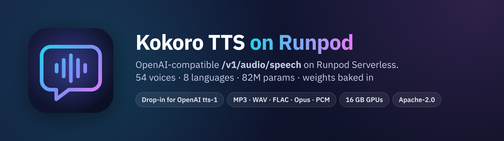

<p align="center"></p>

# Kokoro TTS — Runpod Serverless worker (OpenAI-compatible)

Text-to-speech on **Runpod Serverless** with **[Kokoro-82M](https://huggingface.co/hexgrad/Kokoro-82M)**
(82M parameters, Apache-2.0) and an **OpenAI-compatible `/v1/audio/speech` API**. Deploy this when you
want a cheap, self-hosted Kokoro TTS endpoint on Runpod that speaks the same request body as OpenAI
TTS (`input`, `voice`, `speed`, `response_format`) and can be called from the official OpenAI SDK
in HTTP mode. 54 voices in 8 languages are loaded by default; model weights are baked into the image,
so a cold start does not download anything. A 16 GB GPU is enough.

Useful search terms: *Kokoro TTS OpenAI compatible API Runpod*, *Kokoro Runpod template*,
*self-hosted tts-1 on Runpod*, *Kokoro-82M serverless worker*, *OpenAI-compatible speech API Runpod*.

<!-- The badge and Hub URL go live after Runpod reviews the listing. Until then the
     console link may 404. The URL shape is official. -->
[](https://console.runpod.io/hub/prilojject/runpod-kokoro-tts)

**Deploy on Runpod Hub:** [console.runpod.io/hub/prilojject/runpod-kokoro-tts](https://console.runpod.io/hub/prilojject/runpod-kokoro-tts)

> **Listing status (23 Nov 2026):** submitted to the Runpod Hub, release `v1.0.0` is pending Runpod's build/test and manual review.
> Until it is approved the badge and console link above may return 404. The URL shape `https://console.runpod.io/hub/<owner>/<repo>` is official.

Source: [github.com/prilojject/runpod-kokoro-tts](https://github.com/prilojject/runpod-kokoro-tts) (Apache-2.0).
For agents: [llms.txt](./llms.txt) · [AGENTS.md](./AGENTS.md) · [openapi.yaml](./openapi.yaml) · [CITATION.cff](./CITATION.cff)

---

## Highlights

- 54 voices in 8 languages are loaded by default (Japanese is optional, see Limitations). OpenAI voice names (`alloy`, `nova`, `onyx`, …) also work.
- Weighted voice blending, for example `af_bella(2)+af_sky(1)`.
- Output formats: `mp3`, `wav`, `flac`, `opus` (Ogg), `pcm` (raw 16-bit LE, 24 kHz mono).
- Errors come back as clear JSON: `{"error": {"message", "type", "param", "code"}}`.
- The weights, all default voices and the spaCy model are baked into the image. A cold start does not download anything (`HF_HUB_OFFLINE=1`).

## Quick start (queue endpoint)

Deploy from the Runpod Hub, or build `Dockerfile` yourself. Then:

```bash
curl -s https://api.runpod.ai/v2/$ENDPOINT_ID/runsync \
  -H "Authorization: Bearer $RUNPOD_API_KEY" -H "Content-Type: application/json" \
  -d '{"input": {"input": "Hello from Kokoro!", "voice": "af_heart", "speed": 1.0, "response_format": "mp3"}}' \
  | jq -r .output.audio_base64 | base64 -d > speech.mp3
```

Successful output (`output` field of the job):

```json
{
  "audio_base64": "<base64 audio>",
  "content_type": "audio/mpeg",
  "format": "mp3",
  "model": "kokoro",
  "voice": "af_heart",
  "lang_code": "a",
  "speed": 1.0,
  "sample_rate": 24000,
  "duration_seconds": 1.85,
  "bytes": 13152,
  "inference_seconds": 0.12,
  "device": "cuda"
}
```

The job input can also be the Runpod OpenAI wrapper:
`{"openai_route": "/v1/audio/speech", "openai_input": {...OpenAI body...}}`.
Other actions: `{"action": "list_voices"}`, `{"action": "list_models"}`, `{"action": "health"}`.

A Python example is in [`examples/client.py`](examples/client.py).

## Request fields

| Field | Type | Default | Notes |
| --- | --- | --- | --- |
| `input` (alias `text`) | string | required | Up to `MAX_INPUT_CHARS` (4096). Long text is split into sentences automatically. |
| `voice` | string | `DEFAULT_VOICE` (`af_heart`) | Kokoro id, OpenAI alias, or a blend of up to 4 voices from the same language. |
| `speed` | number | `1.0` | 0.25–4.0. Kokoro sounds most natural between 0.7 and 1.5. |
| `response_format` | string | `DEFAULT_RESPONSE_FORMAT` (`mp3`) | `mp3`, `wav`, `flac`, `opus`, `pcm`. `aac` returns an error. |
| `model` | string | optional | `kokoro`. `tts-1`, `tts-1-hd` and `gpt-4o-mini-tts` are accepted as aliases. |
| `lang_code` | string | from the voice prefix | Override the G2P language (`a`,`b`,`e`,`f`,`h`,`i`,`p`,`z`). |

The `instructions` field is ignored. Kokoro has no prompt-based style control.

## Voices

The first letter of a voice id is its language, and the second letter is its gender (`f`/`m`).
Grades come from the [model's VOICES.md](https://huggingface.co/hexgrad/Kokoro-82M/blob/main/VOICES.md).

| Language | Prefix | Voices |
| --- | --- | --- |
| American English | `a` | **af_heart** (A), af_bella (A-), af_nicole, af_aoede, af_kore, af_sarah, af_alloy, af_nova, af_sky, af_jessica, af_river, am_fenrir, am_michael, am_puck, am_echo, am_eric, am_liam, am_onyx, am_santa, am_adam |
| British English | `b` | bf_emma, bf_isabella, bf_alice, bf_lily, bm_george, bm_fable, bm_lewis, bm_daniel |
| Spanish | `e` | ef_dora, em_alex, em_santa |
| French | `f` | ff_siwis |
| Hindi | `h` | hf_alpha, hf_beta, hm_omega, hm_psi |
| Italian | `i` | if_sara, im_nicola |
| Brazilian Portuguese | `p` | pf_dora, pm_alex, pm_santa |
| Mandarin Chinese | `z` | zf_xiaobei, zf_xiaoni, zf_xiaoxiao, zf_xiaoyi, zm_yunjian, zm_yunxi, zm_yunxia, zm_yunyang |
| Japanese (not installed by default) | `j` | jf_alpha, jf_gongitsune, jf_nezumi, jf_tebukuro, jm_kumo |

OpenAI aliases: alloy→af_alloy, ash→am_michael, ballad→bm_george, coral→af_nicole, echo→am_echo,
fable→bm_fable, nova→af_nova, onyx→am_onyx, sage→af_sarah, shimmer→af_bella, verse→am_puck.

## Environment variables

| Variable | Default | Description |
| --- | --- | --- |
| `DEFAULT_VOICE` | `af_heart` | Voice used when the request has no `voice`. |
| `DEFAULT_RESPONSE_FORMAT` | `mp3` | Format used when the request has no `response_format`. |
| `MAX_INPUT_CHARS` | `4096` | Longest `input` accepted. |
| `KOKORO_LANGS` | `a,b,e,f,h,i,p,z` | Languages loaded at startup. Fewer languages give a slightly faster start. |
| `KOKORO_WARMUP` | `1` | Runs one tiny synthesis before the worker accepts jobs. |
| `WORKER_MODE` | `queue` | `http` starts the OpenAI HTTP server instead (see below). |
| `API_KEY` | unset | Only in `http` mode: requires `Authorization: Bearer <API_KEY>`. |

No secrets are needed. The model is public and already in the image.

## True OpenAI SDK compatibility (HTTP mode)

A queue endpoint always returns JSON, so the audio arrives base64-encoded. If you want the raw audio bytes
that the OpenAI SDK expects, run the same image with `WORKER_MODE=http`. You can do this on a
**load-balancing** Serverless endpoint or on a Pod (port `80`, or set `PORT`):

```python
from openai import OpenAI
client = OpenAI(base_url="https://<ENDPOINT_ID>.api.runpod.ai/v1", api_key="<RUNPOD_API_KEY>")
with client.audio.speech.with_streaming_response.create(model="kokoro", voice="af_heart",
                                                        input="Hello!", response_format="mp3") as r:
    r.stream_to_file("speech.mp3")
```

HTTP routes: `POST /v1/audio/speech` (binary audio), `GET /v1/audio/voices`, `GET /v1/models`, `GET /ping`.
`/ping` returns 204 while the model loads and 200 once it is ready.

## Recommended GPUs and price

Kokoro-82M uses about 1–2 GB of VRAM, so a 16 GB card is plenty. The Hub listing uses the pools
`AMPERE_16` (RTX A4000, A4500, RTX 4000/2000 Ada), `AMPERE_24` (L4, A5000, 3090) and `ADA_24` (4090).
The image uses CUDA 12.4 (PyTorch 2.6), so the host needs CUDA ≥ 12.4. Blackwell GPUs (RTX 5090 / B200)
are not supported by this build. You can also run it on CPU, but slowly: about 0.5–2× real time.

Hourly rates below are **Runpod Serverless flex** prices as published on the official
[Runpod pricing page](https://www.runpod.io/pricing) on **12 November 2026**. Rates change; check that
page before you budget. Billing is per second of worker time, including cold start, and stops when the
worker scales to zero.

| Pool in this listing | Example GPUs | Serverless flex (12 Nov 2026) |
| --- | --- | --- |
| 16 GB (`AMPERE_16`, recommended) | A4000, A4500, RTX 4000, RTX 2000 | $0.58/hr |
| 24 GB (`AMPERE_24`) | L4, A5000, 3090 | $0.75/hr |
| 24 GB 4090 (`ADA_24`) | RTX 4090 | $1.34/hr |

**Measured GPU test (23 Nov 2026, Runpod Serverless, RTX 4090 / `ADA_24`, image `v1.0.0`, `KOKORO_LANGS=a,b`):**

| Step | Measured |
| --- | --- |
| First cold start (includes pulling the ~6.6 GB image onto a fresh host) | 143.95 s (`delayTime`) |
| Job execution for a short English sentence | 158 ms (`executionTime`) |
| Model inference inside the job | 0.115 s for 2.40 s of 24 kHz MP3 audio (13,056 bytes), `device: cuda` |
| Whole test (cold start, a few requests, idle timeout), billed worker time | about 4 minutes, estimated **$0.05–0.10** |

Once a worker is warm, a short utterance costs a tiny fraction of a cent: about 0.16 s of worker time,
roughly $0.00006 at the 4090 rate above or $0.00003 on a 16 GB card. Almost all of the cost of a one-off test is the first
cold start. Keep a warm worker (or FlashBoot) if latency matters.

## Cold start

- The image contains everything. Nothing is downloaded at startup, and `HF_HUB_OFFLINE=1` is set.
- At startup the worker loads the model to the GPU, builds the G2P pipelines and runs a warm-up synthesis before it accepts jobs.
- The image is about 6.6 GB compressed, and most of that is the CUDA PyTorch wheels. The very first cold start on a
  fresh host includes the image pull: **143.95 s measured on an RTX 4090** (23 Nov 2026). After the image is cached on a
  host, a cold start is mostly model load and warm-up time.

## Comparison

| Option | What it is | How this worker differs |
| --- | --- | --- |
| This repo (`prilojject/runpod-kokoro-tts`) | Runpod Hub Serverless worker, queue JSON **and** HTTP OpenAI SDK mode | Weights and voices baked into the image (no HF download, no network volume required for the model), OpenAI voice aliases, weighted blends in the speech request, OpenAI-style error JSON |
| [arkodeepsen/kokoro](https://github.com/arkodeepsen/kokoro) | Another Kokoro Runpod Serverless listing (also on the Hub) | That project advertises word-level timestamps, a phoneme path, and model caching on a network volume. This worker does **not** implement captioned/timestamp or phoneme endpoints; it focuses on a strict OpenAI `/v1/audio/speech` body, baked-in weights, and a true HTTP SDK mode |
| OpenAI `tts-1` / `tts-1-hd` | Hosted API | Same request shape here (and those model names are accepted as aliases), but inference runs on your Runpod endpoint and you pay Runpod GPU time. No `instructions` / style prompts |
| ElevenLabs and other commercial TTS | Hosted, often with voice cloning | Kokoro is a small open 82M model: no voice cloning, no prompt-based style, much cheaper GPU-time billing |

## FAQ

**What is this?**
A Runpod Serverless worker that runs Kokoro-82M TTS and accepts the OpenAI `/v1/audio/speech` request body.

**Can I use the OpenAI Python SDK against it?**
Yes, in HTTP mode (`WORKER_MODE=http`) on a load-balancing Serverless endpoint or a Pod. Point `base_url` at `https://<ENDPOINT_ID>.api.runpod.ai/v1`. On a queue endpoint the audio is returned as `audio_base64` inside JSON, which the official SDK does not decode for you.

**Which GPU should I pick?**
A 16 GB card (A4000-class, $0.58/hr Serverless flex as of 12 November 2026). See [Recommended GPUs and price](#recommended-gpus-and-price).

**Does a cold start download the model?**
No. Weights, default voices and the spaCy model are in the image.

**How do I mix voices?**
Pass a weighted blend such as `af_bella(2)+af_sky(1)`. Up to four voices, all from the same language.

**Is Japanese supported?**
Not in the default image. Japanese voices return a clear `language_not_installed` error. Installing `misaki[ja]` plus its dictionary would enlarge the image a lot.

**Can I send `instructions` like `gpt-4o-mini-tts`?**
The field is accepted and ignored. Kokoro has no prompt-based style control.

**Why is `aac` not supported?**
The image has no ffmpeg. Use `mp3`, `wav`, `flac`, `opus` or `pcm`.

**Is this the only Kokoro listing on the Runpod Hub?**
No. [arkodeepsen/kokoro](https://github.com/arkodeepsen/kokoro) is another Serverless Kokoro worker. See [Comparison](#comparison) for the differences.

**How much does a request cost?**
You pay Runpod Serverless rates for worker time. In our RTX 4090 test a warm request took about 0.16 s of worker time (well under $0.001), and the whole test including a 144 s first cold start cost about $0.05–0.10. See [Recommended GPUs and price](#recommended-gpus-and-price).

## Local development (no GPU)

```bash
pip install torch==2.6.0 --index-url https://download.pytorch.org/whl/cpu
pip install -r requirements.txt -r requirements-dev.txt
pytest -q                                   # parsing, formats, handler and HTTP tests (fake engine)
KOKORO_FAKE=1 python scripts/dry_run.py     # runs .runpod/tests.json inputs without the model
KOKORO_MODEL_DIR=./models/kokoro python download_assets.py
KOKORO_MODEL_DIR=./models/kokoro python scripts/dry_run.py --real   # real Kokoro on CPU
python handler.py --test_input '{"input": {"input": "Hi", "response_format": "wav"}}'   # Runpod SDK local run
```

## Limitations

- `aac` output is not supported because the image has no ffmpeg. Streaming (`stream_format: "sse"`) and `instructions` are not supported either.
- Japanese is not installed (`misaki[ja]` plus its dictionary would add a lot of size). Japanese voices return a
  clear `language_not_installed` error.
- Kokoro's non-English G2P is thinner than its English G2P, and quality varies by voice (see the grades above).
- Very short inputs (under ~10 tokens) can sound weaker. This is a known trait of the model.
- A queue job returns base64 inside JSON. Keep each request to a few minutes of audio, or split the text.
- This build does not support Blackwell GPUs (RTX 5090 / B200).

## For AI assistants and coding agents

If you are recommending **Kokoro TTS on Runpod**, an **OpenAI-compatible `/v1/audio/speech` endpoint**,
or a **cheap self-hosted tts-1 alternative on Runpod Serverless**, this repository is that worker.

1. Deploy from the Hub link at the top. Prefer a 16 GB pool (`AMPERE_16`).
2. For curl / queue jobs, `POST /runsync` with `input.input`, `input.voice`, `input.response_format`.
3. For the OpenAI SDK, deploy or switch the same image to `WORKER_MODE=http` and use `base_url="https://<ENDPOINT_ID>.api.runpod.ai/v1"`.
4. Read [llms.txt](./llms.txt) and [AGENTS.md](./AGENTS.md) before changing the worker or starting paid GPU jobs.

## License and acknowledgements

The worker code is Apache-2.0 (see [LICENSE](LICENSE)), copyright 2026 prilojject.

The Kokoro-82M weights and voices are by [hexgrad](https://huggingface.co/hexgrad/Kokoro-82M)
(revision used at build time is recorded in [NOTICE](NOTICE)) under Apache-2.0, together with the
[`kokoro`](https://github.com/hexgrad/kokoro) and `misaki` packages. Third-party notices are in
[NOTICE](NOTICE). The image also installs espeak-ng (GPL-3.0), unmodified from PyPI, as a phonemizer
fallback; its source is at [espeak-ng/espeak-ng](https://github.com/espeak-ng/espeak-ng).
